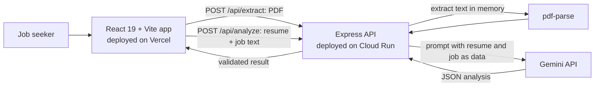

# HirePilot

HirePilot helps a job seeker compare their resume with a job description. The React app accepts pasted resume text or a PDF, extracts PDF text for review, and sends the resume and job description to an Express API for a Gemini-powered match analysis. The results include a score, matched skills with resume evidence, missing skills with importance, and suggested skills.

Resume generation, cover letters, history, and fetching a job description from a URL are still mock or coming-soon features.

## Architecture



The frontend API base URL comes from `VITE_API_URL`. The backend accepts one configured CORS origin through `ALLOWED_ORIGIN`.

## API contract

`/api/extract` accepts multipart form data; other request bodies are JSON. Successful responses and application errors are JSON. Rate-limit responses use the rate limiter's default `429` response.

### `GET /health`

Returns `200` when the API is running:

```json
{ "ok": true }
```

### `POST /api/extract`

Send `multipart/form-data` with one PDF in the `file` field. The file must have MIME type `application/pdf` and be no larger than 5 MB.

Success (`200`):

```json
{ "text": "Extracted resume text..." }
```

Errors: `400` for a missing file or malformed upload, `413` when the file exceeds 5 MB, `415` for a non-PDF MIME type, and `422` when the PDF cannot be read or contains fewer than 200 extracted characters. The latter can indicate a scanned PDF.

### `POST /api/analyze`

Send JSON with non-empty `resumeText` and `jobText` strings. Each field is limited to 15,000 characters. Job URL fetching is not implemented; send the job description text.

```json
{
  "resumeText": "Resume content...",
  "jobText": "Job description..."
}
```

Success (`200`) follows this shape:

```json
{
  "score": 78,
  "matched": [
    { "skill": "React", "evidence": "Built a dashboard using React." }
  ],
  "missing": [
    { "skill": "Kubernetes", "importance": "medium" }
  ],
  "suggested": ["CI/CD"]
}
```

`score` is from 0 to 100. Each `matched.evidence` value must quote the resume; the API removes matched entries whose evidence is not found in the resume after case and whitespace normalization. `missing.importance` is `high`, `medium`, or `low`.

Errors: `400` for invalid input, `429` when rate limited, and `502` when Gemini fails or returns output that remains invalid after one retry.

## Run locally

Use two terminals from the repository root.

### Backend

```sh
cd server
npm install
cp .env.example .env
```

Set `GEMINI_API_KEY` in `server/.env`. The example config uses `PORT=8080` and `ALLOWED_ORIGIN=http://localhost:5173`.

```sh
npm run dev
```

### Frontend

In the second terminal:

```sh
npm install
cp .env.example .env
npm run dev
```

The frontend example sets `VITE_API_URL=http://localhost:8080`. Local `.env` files are ignored by Git; keep API keys out of source control.

## Run the evaluation

From the repository root:

```sh
cd server
node eval/run.js
```

The script requires `GEMINI_API_KEY` in `server/.env`. It evaluates six short synthetic resume/job pairs, including a prompt-injection case, and prints a table of found versus expected matched and missing skills. For the injection case, it compares the result with a control analysis whose job text omits the injected instruction.

### Evaluation results

Fill these in after running the evaluation:

| Metric | Result |
| --- | --- |
| Overall recall | _TBD_ |
| Unexpected matched skills | _TBD_ |
| Prompt injection changed output | _TBD_ |

## Limitations & Security

- **Scanned PDFs:** Extraction is text-based and does not run OCR. PDFs with fewer than 200 extracted characters receive `422`; users need a text-based PDF for now.
- **Model errors:** Gemini can fail or return malformed or inaccurate analysis. The API validates the result with Zod, retries once, then returns `502`. Resume evidence is checked against the supplied resume, but the score and other analysis fields still need human review.
- **Prompt injection:** The prompt explicitly treats content in `<resume>` and `<job>` blocks as data, not instructions. This reduces instruction-following risk but cannot guarantee the model will ignore every malicious instruction. The evaluation includes a job-description injection case and compares it with a control run.
- **Resume privacy:** The backend does not log resume text. PDFs are held in memory for extraction; the app does not persist resume text. Analysis sends resume and job text to Gemini for processing.
- **Rate limits:** PDF extraction is limited to 30 requests per 15 minutes per IP; analysis is limited to 10 per minute per IP. The default limiter stores counts in process memory, so limits are not shared globally across multiple Cloud Run instances.
- **Request and origin limits:** JSON requests are limited to 1 MB. CORS allows only the configured `ALLOWED_ORIGIN`; set it to the exact deployed Vercel origin.
- **Secrets:** Keep `GEMINI_API_KEY` in a local ignored `.env` for development and in Secret Manager for Cloud Run. Do not commit `.env` files or bake secrets into the image.
- **Runtime:** The requested Docker image uses Node 20. Node 20 is end-of-life; upgrade to a maintained Node release before production.

## Next steps

- Deploy the frontend to Vercel and set `VITE_API_URL` to the Cloud Run service URL; set Cloud Run `ALLOWED_ORIGIN` to the exact Vercel origin.
- Add OCR or a clear scanned-PDF alternative flow.
- Review evaluation results, refine expected labels, and add more synthetic cases for edge conditions and prompt injection.
- Connect resume generation and cover-letter generation to backend endpoints, replacing the mock previews.
- Add URL-based job description import with safe fetching and server-side validation.
- Consider shared rate-limit storage and request monitoring before increasing Cloud Run instances.
